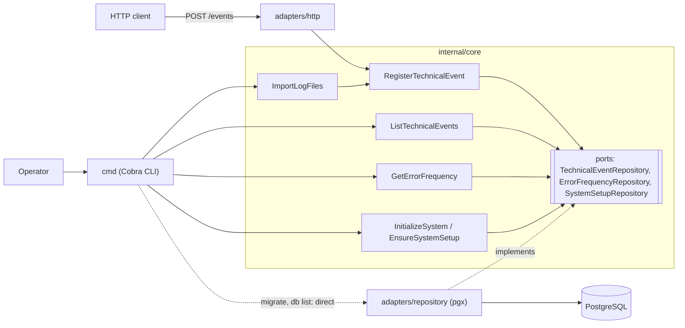

# TraceLog

[](https://github.com/svitorz/tracelog/actions/workflows/ci.yml)

TraceLog ingests technical events and log files, normalizes them and stores them in PostgreSQL, so you can ask simple questions from the command line: what failed, when, and how often. It is a small Go service with a hexagonal layout, built as an MVP: one HTTP endpoint, a log importer and a CLI.

## Quickstart

Requires Docker and `curl`.

```bash
git clone https://github.com/svitorz/tracelog.git
cd tracelog
cp .env.example .env
make demo            # or: ./scripts/demo.sh
```

`make demo` starts PostgreSQL, applies the migrations, creates the default setup, starts the API, imports the synthetic logs in [`examples/logs/`](./examples/logs/), sends a few events with `curl` and queries the result. If port 5432 or 8080 is already taken on your machine, change `DB_PORT` or `HTTP_PORT` in `.env`.

Excerpt of a real run on an empty database (full output in [`docs/demo-output.txt`](./docs/demo-output.txt); the demo runs the CLI inside the container, `tracelog` there is `docker compose run --rm api`):

```text
$ docker compose up -d --wait
SERVICE    STATUS
api        Up 5 seconds (healthy)
init       Exited (0) 5 seconds ago
migrate    Exited (0) 6 seconds ago
postgres   Up 12 seconds (healthy)

$ tracelog import logs --file /examples/checkout-api.log --file /examples/auth-service.log --file /examples/legacy-gateway.log
Log import summary
Files processed: 3
Lines read: 434
Persisted: 429
Duplicates (already imported): 0
Blank lines skipped: 5
Normalized: 378
Partially interpreted: 20
Uncategorizable: 31

$ tracelog metrics errors --from 2026-03-01 --to 2026-03-14
DATE        ERRORS  FATAL  TOTAL
----        ------  -----  -----
2026-03-01  2       0      2
2026-03-02  2       0      2
2026-03-03  1       0      1
2026-03-05  1       0      1
2026-03-06  1       0      1
2026-03-08  1       0      1
2026-03-09  2       0      2
2026-03-10  25      1      26
2026-03-11  1       0      1
2026-03-13  1       0      1
2026-03-14  2       0      2

Summary:
  Days with errors: 11
  Errors: 39
  Fatal: 1
  Average (error+fatal) per day with errors: 3.6
```

The spike on 2026-03-10 is the simulated database outage in the example data.

To start only the stack: `docker compose up -d --wait` (or `make up`). The API listens on `127.0.0.1:${HTTP_PORT}`.

## Sending events

```bash
curl -X POST http://localhost:8080/events \
  -H 'Content-Type: application/json' \
  -d '{"external_id":"order-42","message":"payment provider timeout","occurred_at":"2026-03-14T18:00:00Z","category":"system"}'
```

Sending the same `external_id` again for the same application is safe. Real responses from the demo:

```text
$ curl -X POST http://127.0.0.1:18083/events   # evento novo
{"id":"7a6206f0-bff1-4099-b85c-8746b5a0dee9","external_id":"demo-0001","received_at":"2026-11-20T20:58:24.671741Z","created_at":"2026-11-20T20:58:24.674644Z","duplicate":false}

[HTTP 201]

$ curl -X POST http://127.0.0.1:18083/events   # reenvio do mesmo external_id
{"id":"7a6206f0-bff1-4099-b85c-8746b5a0dee9","external_id":"demo-0001","received_at":"2026-11-20T20:58:24.671741Z","created_at":"2026-11-20T20:58:24.674644Z","duplicate":true}

[HTTP 200]
```

Every field is optional. Missing or invalid values are normalized and the change is recorded in `payload._ingestion`; references (`application_id`, `source_id`, `environment_id`) fall back to the default setup. The API answers `413` for bodies over `HTTP_MAX_BODY_BYTES` (1 MiB by default), `415` for a `Content-Type` other than JSON and `500` with a generic message (details only in the server log). `GET /health` is liveness; `GET /ready` checks the database.

## Command line

| Command | What it does |
|---------|--------------|
| `tracelog serve` | Starts the HTTP API (graceful shutdown on SIGINT/SIGTERM) |
| `tracelog migrate` | Applies the migrations embedded in the binary, once each |
| `tracelog init [--defaults]` | Creates the default application, environment and source |
| `tracelog import logs --file ...` | Imports JSON, `timestamp level message` and free-text log lines; re-importing does not duplicate |
| `tracelog events list` | Lists events with filters (`--severity`, `--application-id`, `--environment-id`, `--from`, `--to`, `--limit`) |
| `tracelog metrics errors` | Counts `error` and `fatal` events per UTC day |
| `tracelog db list environments\|applications\|sources` | Shows the setup entities and their IDs |

## Architecture



Use cases depend only on the domain and on the port interfaces; the PostgreSQL adapter implements the ports. Two commands skip the use-case layer on purpose: `migrate` (infrastructure, not business logic) and `db list`, which still runs its three read-only queries directly in `cmd/db.go`.

## What it does not do

- No dashboard or web UI.
- No authentication, TLS or rate limiting: the Docker setup publishes ports on `127.0.0.1` only and uses a default database password. Do not expose it.
- No search, grouping by fingerprint, alerting or per-`trace_id` view yet.
- No batch endpoint: one event per `POST /events`.

## Design decisions and known limitations

- **Never drop an event that can be stored.** Malformed JSON is stored with the decode error; the API only refuses what it cannot store (`413`, `415`, `500`).
- **Severity is derived by the server**, with a keyword heuristic on whole words of the message and payload. A client cannot set it. The heuristic has no notion of negation: `0 errors found` is classified as `error`.
- **`metrics errors` reports `error` and `fatal` separately**, per UTC day; days without errors are omitted.
- **Idempotency:** `(application_id, external_id)` is unique; a resend returns `200` with `"duplicate": true`. Imported lines get an `external_id` derived from file name, line number and content.
- **Import speed vs. durability:** the import connection uses `synchronous_commit=off` (80,266 lines in 34 s instead of 334 s on the test machine). A PostgreSQL crash may lose the last ~0.6 s of commits; re-importing fixes it.
- Oversized identifiers are truncated (`external_id` at 255 characters), so two long IDs sharing that prefix collide.

The full list, with the reasoning, is in the [project guide](./docs/guia-do-projeto.md) and the [specs](./docs/specs/).

## Development

Requires Go 1.26.11 (from `go.mod`; `GOTOOLCHAIN=auto` downloads it).

```bash
make lint     # gofmt check + go vet
make test     # go test -race ./...
make build    # bin/tracelog
```

Repository integration tests run only when `TRACELOG_TEST_DATABASE_URL` points to a PostgreSQL database; each test uses its own throwaway schema. CI runs formatting, vet, race-enabled tests against PostgreSQL 16, the build and a Docker image build.

## Documentation

- [Project guide](./docs/guia-do-projeto.md) (Portuguese): configuration, API, CLI, rules, data model, tests, limitations.
- [Specs](./docs/specs/): the decisions behind each change.
- [AGENTS.md](./AGENTS.md): rules for contributors and AI agents.

## License

TraceLog is free software licensed under the [GNU General Public License v3.0](./LICENSE).

Copyright (C) 2026 Vitor Fábio. See [LICENSE](./LICENSE) for the full terms.
