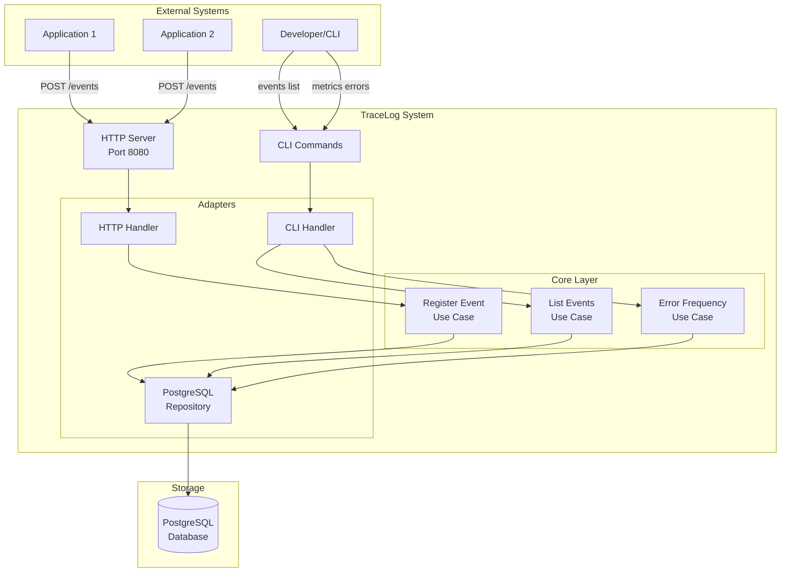

# TraceLog Architecture

## Overview

TraceLog is built using **Hexagonal Architecture** (also known as Ports and Adapters), which provides clear separation between business logic and infrastructure concerns. This architecture enables flexibility in swapping adapters (HTTP, RabbitMQ, different databases) without affecting the core domain logic.

The system is composed of three main layers:

1. **Core Domain**: Business entities and rules
2. **Ports**: Interfaces defining contracts
3. **Adapters**: Concrete implementations of ports (HTTP, CLI, PostgreSQL)

## System Flow



## Event Flow

### 1. Event Ingestion (Write Path)

```
Application → HTTP POST /events → HTTP Handler → RegisterTechnicalEventUseCase → Repository → PostgreSQL
```

**Steps**:
1. Application sends event via HTTP POST with JSON payload
2. HTTP handler validates and deserializes the request
3. Use case applies business rules (validations, ID generation, timestamps)
4. Repository adapter persists to PostgreSQL
5. HTTP response confirms success or returns error

### 2. Event Query (Read Path)

```
Developer → CLI Command → CLI Handler → ListTechnicalEventsUseCase → Repository → PostgreSQL
```

**Steps**:
1. Developer executes CLI command (e.g., `tracelog events list --severity error`)
2. CLI handler parses arguments and builds filters
3. Use case applies query logic and constraints
4. Repository adapter queries PostgreSQL with filters
5. CLI formats and displays results

### 3. Metrics Analysis

```
Developer → CLI Command → CLI Handler → GetErrorFrequencyUseCase → Repository → PostgreSQL
```

**Steps**:
1. Developer requests metrics (e.g., `tracelog metrics errors`)
2. CLI handler parses date range and application filters
3. Use case executes aggregation logic
4. Repository performs GROUP BY queries for frequency data
5. CLI displays metrics in tabular format

## Core Components

### 1. Domain Layer (`internal/core/domain/`)

Contains business entities and value objects:

- **TechnicalEvent**: Main entity representing a logged event
- **ErrorFrequency**: Aggregated metric for error analysis
- **MonitoredApplication**: Applications being tracked
- **Environment**: Deployment environments (local, dev, staging, prod)
- **EventSource**: Origin of events (API, background job, cron, etc.)

**Key characteristics**:
- No external dependencies
- Pure Go structs with business validation
- Domain-specific types (Severity, IngestionChannel)

### 2. Ports Layer (`internal/core/ports/`)

Defines contracts between core and adapters:

- **TechnicalEventRepository**: Interface for event persistence
- **ErrorFrequencyRepository**: Interface for metrics queries

**Purpose**:
- Decouple business logic from infrastructure
- Enable testing with mock implementations
- Allow adapter replacement without changing use cases

### 3. Services Layer (`internal/core/services/`)

Implements use cases (application logic):

- **RegisterTechnicalEventUseCase**: Handles event creation and validation
- **ListTechnicalEventsUseCase**: Queries events with filters
- **GetErrorFrequencyUseCase**: Calculates error metrics

**Responsibilities**:
- Coordinate domain entities
- Apply business rules
- Orchestrate repository calls
- Return structured responses

### 4. Adapters Layer (`internal/adapters/`)

Concrete implementations of ports:

#### HTTP Adapter (`adapters/http/`)
- **server.go**: HTTP server setup with routing
- **event_handler.go**: Request handling and response formatting
- **dto.go**: Data Transfer Objects for HTTP API

#### Repository Adapter (`adapters/repository/`)
- **postgres.go**: PostgreSQL connection and base operations
- **technical_event_repository.go**: Event persistence implementation
- **error_frequency_repository.go**: Metrics queries implementation

#### CLI Adapter (`cmd/`)
- **root.go**: CLI framework setup (Cobra)
- **serve.go**: HTTP server command
- **events.go**: Event query commands
- **metrics.go**: Metrics commands
- **db.go**: Database management commands

## Component Responsibilities

### HTTP Server

**Role**: Event ingestion endpoint

**Responsibilities**:
- Listen on configured port (default 8080)
- Parse and validate incoming JSON payloads
- Route requests to appropriate handlers
- Return HTTP status codes and error messages

**Technology**: Standard library `net/http` with custom routing

**Lifecycle**:
- Started via `tracelog serve` command
- Runs until SIGINT/SIGTERM received
- Graceful shutdown on termination signals

### PostgreSQL Database

**Role**: Persistent storage for all data

**Responsibilities**:
- Store technical events with full history
- Store reference data (applications, environments, sources)
- Execute filtered queries with date ranges
- Perform aggregations for metrics

**Schema**:
- `technical_events`: Event records with JSON metadata
- `monitored_applications`: Applications being tracked
- `environments`: Deployment environments
- `event_sources`: Event origin types

**Access Pattern**:
- Write-heavy for event ingestion
- Read-heavy for CLI queries and metrics
- Indexed on `occurred_at`, `severity`, `application_id`

### CLI

**Role**: Primary interface for developers

**Responsibilities**:
- Start HTTP server (`serve`)
- Query events with filters (`events list`)
- Display error metrics (`metrics errors`)
- Manage database entities (`db list`)

**Implementation**: Cobra framework for command parsing and help text

**User Experience**:
- POSIX-compliant flags
- Colorized output (future enhancement)
- Tabular data formatting

## Configuration

Centralized in `.env` file:

```env
APP_NAME=tracelog
APP_ENV=local
HTTP_PORT=8080
DB_HOST=localhost
DB_PORT=5432
DB_NAME=tracelog
DB_USER=postgres
DB_PASSWORD=postgres
DB_SSLMODE=disable
```

Configuration is loaded once at startup and used across all components.

## Future Architecture Evolution

### RabbitMQ Integration

**Purpose**: Asynchronous event ingestion

**Architecture Changes**:
```
Application → RabbitMQ → Consumer Worker → RegisterTechnicalEventUseCase → Repository → PostgreSQL
```

**Benefits**:
- Decouple event producers from TraceLog availability
- Handle traffic spikes with message buffering
- Enable multiple consumer instances for scalability
- Retry failed ingestions automatically

**Implementation Plan**:
- Create new AMQP adapter (`adapters/amqp/consumer.go`)
- Reuse existing `RegisterTechnicalEventUseCase`
- Add queue configuration to `.env`
- Deploy consumer as separate process

### Grafana Integration

**Purpose**: Visual dashboards and alerting

**Architecture Changes**:
```
Grafana → PostgreSQL (read-only queries)
Grafana → TraceLog HTTP API (optional)
```

**Features**:
- Real-time event dashboards
- Error rate trends over time
- Application health overview
- Alert rules for critical errors

**Implementation Plan**:
- Create Grafana datasource configuration
- Develop pre-built dashboard templates
- Document custom query examples
- Add Grafana to `docker-compose.yml`

### Extended Observability Stack

**Future Components**:

1. **Event Correlation Service**:
   - Link related events across applications
   - Trace request flows through system boundaries

2. **Alert Manager**:
   - Threshold-based alerting
   - Notification channels (email, Slack, webhooks)

3. **Data Retention Service**:
   - Automatic archival of old events
   - Configurable retention policies
   - Export to cold storage

## Testing Strategy

### Unit Tests
- Use case tests with mock repositories
- Domain entity validation tests
- Business rule verification

### Integration Tests
- HTTP handler tests with real use cases
- Repository tests with test database
- End-to-end API tests

### Example Test Structure
```
internal/core/services/register_technical_event_usecase_test.go
internal/adapters/http/event_handler_test.go
```

## Dependencies

**External Libraries**:
- `github.com/lib/pq`: PostgreSQL driver
- `github.com/spf13/cobra`: CLI framework
- `github.com/joho/godotenv`: Environment configuration

**Design Decision**: Minimal dependencies to reduce maintenance burden and security surface.

## Deployment

**Current State**: Local development only

**Future Options**:
- Docker container for HTTP server
- Kubernetes deployment for production
- Systemd service for Linux servers

## Contributing

When adding new features:

1. **Start with domain**: Define entities in `internal/core/domain/`
2. **Create ports**: Define repository interfaces in `internal/core/ports/`
3. **Implement use case**: Add business logic in `internal/core/services/`
4. **Add adapter**: Implement concrete adapter in `internal/adapters/`
5. **Wire up CLI/HTTP**: Connect adapter to user interface
6. **Write tests**: Unit tests for use cases, integration tests for adapters

Follow the dependency rule: **Dependencies always point inward toward the core**.

```
CLI/HTTP → Use Cases → Domain
                ↓
          Repositories → Database
```

---

**Last Updated**: March 2026  
**Status**: MVP in active development
